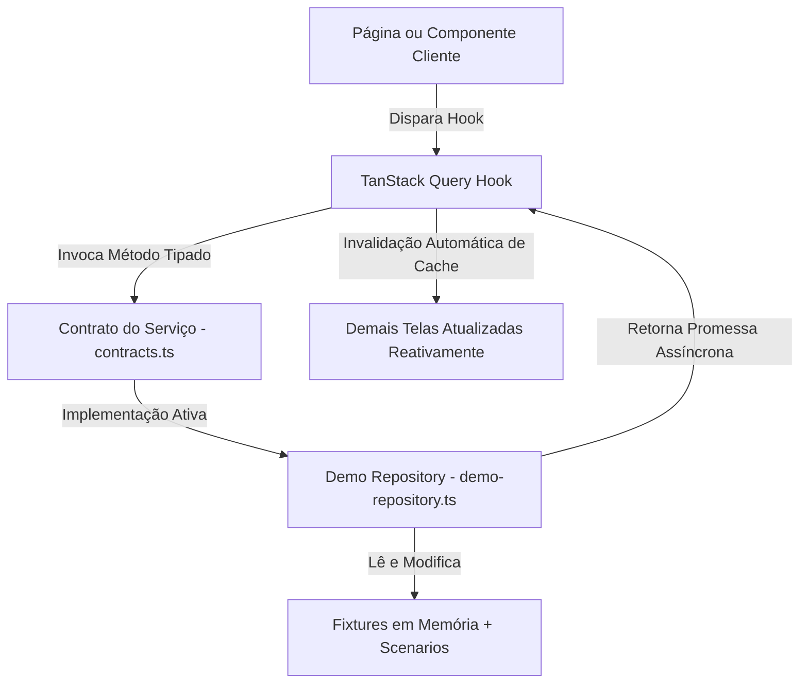

# ARQUITETURA DO FRONTEND

Este documento descreve a arquitetura técnica, divisão de fronteiras Server/Client, fluxo de dados reativo, modelagem do repositório demonstrativo e diretrizes para substituição futura por uma API HTTP/tRPC real.

---

## 1. Visão Geral e Fronteiras Server / Client

A aplicação utiliza o **Next.js App Router (React 19)** com tipagem estrita no TypeScript.

* **Server Components (`layout.tsx`, `page.tsx` por padrão):**
  * Responsáveis pela estrutura inicial do documento, metadados (`<title>`, `<meta>`), importação de fontes do sistema e definição do esqueleto inicial da rota.
  * Preservam leveza de bundle e SEO técnico.
* **Client Components (`"use client"` pontual):**
  * Tabelas interativas (`TanStack Table`), formulários com validação (`React Hook Form` + `Zod`), modais/drawers, seletores de filtro com URL searchParams e gráficos (`Recharts`).
  * Envolvidos por providers de contexto (`QueryProvider`, `DemoProvider`, `PreferencesProvider`) sem converter árvores filhas estáticas em código cliente.

---

## 2. Fluxo de Dados e Estado

O fluxo de dados é estritamente unidirecional e previsível:

### Regras de Coerência Contábil
* **Cálculo em Centavos:** Todos os valores monetários internos são manipulados como inteiros em centavos (`amountInCents`) para impedir desvios de arredondamento IEEE 754.
* **Saldo Disponível:**
  $$\text{Saldo Disponível} = \text{Saldo Contabilizado} - \text{Reservas Ativas}$$
* **Cobranças Pix:**
  * Status: `DRAFT` $\to$ `PENDING` $\to$ `PAID` ou `EXPIRED`.
  * Cobranças emitidas permanecem pendentes sem somar ao saldo. Ao serem pagas na simulação, liquidam o valor líquido na conta e geram os lançamentos contábeis de entrada e tarifa correspondentes.
* **Saques Pix:**
  * Status: `PENDING_APPROVAL` (quando aplicável regra de aprovação) $\to$ `PROCESSING` $\to$ `COMPLETED` ou `REJECTED` / `FAILED`.
  * Criação de saque reserva atomicamente `(principal + tarifa)` do saldo disponível.
  * Conclusão efetiva baixa a reserva e consolida o lançamento de débito no extrato. Rejeição ou falha cancela a reserva devolvendo o saldo imediatamente.
* **Saques em Lote:**
  * Particiona o valor total (mínimo R$ 30.000,00) em parcelas unitárias de até R$ 15.000,00 para a mesma chave Pix.
  * O lote agrega o status e valores de suas parcelas (evitando duplicar o débito do lote sobre o débito das parcelas).

---

## 3. Arquitetura de Layout e Scroll (Modelo Híbrido)

* **Desktop (Largura $\ge$ 1024px):**
  * Layout Shell fixo.
  * Topbar (`64px`) ancorado com CommandDialog (`Ctrl+K`), notificações, perfil e botão de privacidade.
  * Sidebar (`248px`) recolhível para modo trilho (`64px`) com tooltips e foco por teclado.
  * Área de trabalho interna com rolagem independente (`overflow-y: auto`) e largura máxima de `1440px`.
* **Mobile (Largura < 1024px):**
  * Rolagem nativa no body da janela com respeito total a `100dvh`, barras de ferramentas do navegador e teclado virtual.
  * Topbar enxuto com busca e perfil.
  * Barra inferior (`BottomNav`) com 5 pontos de toque ergonômicos:
    1. Início
    2. Movimentações
    3. Pix (Hub central com drawer de ações imediatas + link `/pix`)
    4. Aprovações (com contador de pendências)
    5. Mais (configurações, taxas, segurança, webhooks e ajuda)

---

## 4. Repositório Demonstrativo e Cenários

O repositório em memória suporta alternância rápida de cenários para testes visuais e de produto:

| Cenário | Descrição |
| :--- | :--- |
| **Normal (Padrão)** | Saldo inicial R$ 120.000,00; 60+ transações em 6 meses; lotes e regras ativas. |
| **Conta Nova** | Saldo R$ 0,00; sem histórico; exibe telas de onboarding e empty states amigáveis. |
| **Saldo Insuficiente** | Saldo residual de R$ 50,00 para demonstrar bloqueio preventivo de saques. |
| **Limite Atingido** | Limite diário de R$ 100.000,00 atingido; bloqueia novas solicitações no dia. |
| **Fila de Aprovações** | Solicitações pendentes aguardando aprovação sequencial e paralela. |
| **Lote Parcial** | Lote contendo parcelas pagas com sucesso e uma parcela falhada. |
| **Cobrança Expirada** | Cobrança com prazo vencido para demonstrar reemissão com preservação de dados. |
| **Apenas Consulta** | Usuário com permissão de leitura; desabilita botões de ação e exibe avisos contextuais. |

---

## 5. Substituição Futura por API Real

Para migrar esta aplicação para um backend real em produção:
1. Manter integralmente as interfaces definidas em `src/services/contracts.ts`.
2. Criar uma nova implementação de classe (ex.: `HttpGatewayService implements IGatewayService`) em `src/services/http-service.ts`.
3. Substituir a injeção do serviço no `src/providers/demo-provider.tsx` pela instância HTTP.
4. Nenhuma página, hook ou componente visual precisará ser reescrito.
